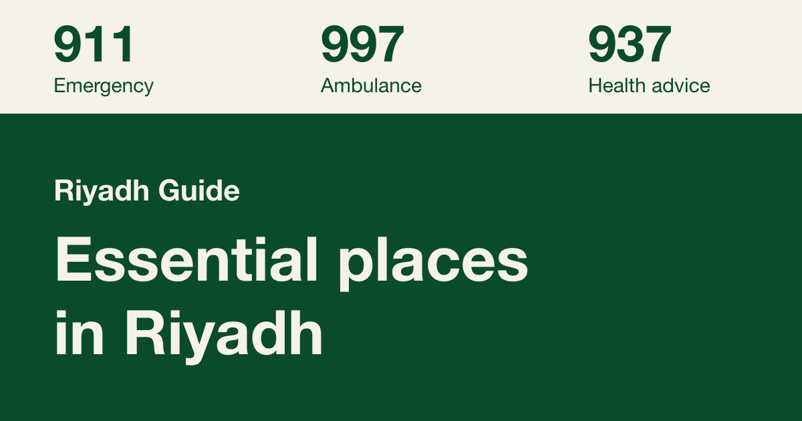

# Janbak (جنبك)

[](https://github.com/amsultan2010/janbak-riyadh/actions/workflows/ci.yml)
[](LICENSE)
[](LICENSE-DATA.md)

<p dir="rtl" lang="ar">
دليل ثابت لسكان الرياض: الأماكن الأساسية وساعات عملها والاتجاهات إليها، وأرقام الاتصال، والروابط الرسمية. بالعربية والإنجليزية، ومفتوح المصدر.
</p>

A plain, bilingual reference for people in Riyadh: where the essential places are, when
they are open, how far they are, and which numbers to call. Arabic at `/`, English at `/en/`.

**Live site: [janbaksa.com](https://www.janbaksa.com)**



## What is in it

- About 2,000 places in eight categories: hospitals and urgent care, pharmacies, blood
  donation and dialysis, mental health, supermarkets, fuel stations, public transport and
  embassies. Each has hours where they are published, a call button and directions.
- Emergency and service phone lines, ways to help, and official links, each taken from an
  official page.
- A map with search, an open-now switch, a district filter and nearest-first sorting.
- No accounts, no backend, no tracking. A location you set stays on your device.

It is Riyadh only, and it carries no news, live status, alerts or crowd-sourced content.
See [PLAN.md](PLAN.md) for the full description and the known gaps.

## Run it

You need Node 22.12 or newer.

```bash
git clone https://github.com/amsultan2010/janbak-riyadh.git
cd janbak-riyadh
npm install
npm run dev
```

The site is then at `http://localhost:4321`.

| Command | What it does |
| --- | --- |
| `npm run dev` | Builds the data, then starts the dev server on port 4321 |
| `npm run build` | Builds the data, then the static site into `dist/` |
| `npm run data` | Merges `research/*.json` into `src/data/places.json` (generated, not committed) |
| `npm test` | Runs the opening-hours tests |
| `node scripts/make-images.mjs` | Regenerates the favicon and share images |

Set `SITE_URL` when building for your own address. It feeds canonical links, the sitemap
and the share images.

## How the data works

Everything the site shows about a place comes from `research/`:

- `research/*.json` is the first pass, with a source for each entry.
- `research/verify/*.json` is the second pass: corrections and fills checked against the
  facility's own site or the ministry.
- `npm run data` validates both, merges them and warns about anything that does not match.

To fix a place, edit it in `research/` and record where the new value comes from. Phone
numbers and official links are only accepted with an official source. If you would rather
not edit JSON, [open a data correction](https://github.com/amsultan2010/janbak-riyadh/issues/new/choose)
with the link and it will be checked.

## Layout

| Path | What lives there |
| --- | --- |
| `research/` | Researched data with sources |
| `scripts/build-data.mjs` | Validation and merge |
| `src/pages/[...lang]/` | One file per page, rendered once per language |
| `src/i18n.js`, `src/content.js` | Interface text and page content, always in both languages |
| `src/lib/hours.js` | Opening-hours parsing and open-now logic |
| `src/components/Explorer.astro`, `src/scripts/explorer.js`, `src/scripts/map.js` | The place finder and its map |
| `src/components/Directory.astro`, `src/scripts/directory.js` | The searchable lists on Numbers, Help and Links |
| `test/` | Tests |

## Contributing

Corrections are the most useful contribution: a wrong phone number, changed hours, a place
that moved or closed. Read [CONTRIBUTING.md](CONTRIBUTING.md) before opening a pull request,
and the [code of conduct](CODE_OF_CONDUCT.md) before taking part. Security problems go
through [SECURITY.md](SECURITY.md), not public issues.

## Licence

- Code, interface text and design: [MIT](LICENSE).
- The dataset in `research/`: [Open Database License 1.0](LICENSE-DATA.md). Parts of it
  come from OpenStreetMap, © OpenStreetMap contributors.
- Fonts, the map library and the map services keep their own terms, listed in
  [THIRD_PARTY_NOTICES.md](THIRD_PARTY_NOTICES.md).

## A note on accuracy

The lists are not complete, and hours and numbers can change after the check date, most of
all in Ramadan and on holidays. In an emergency do not rely on this site: call 911, or 997
for an ambulance.
